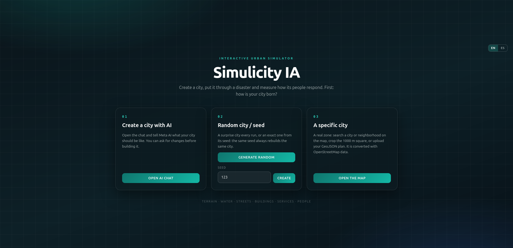
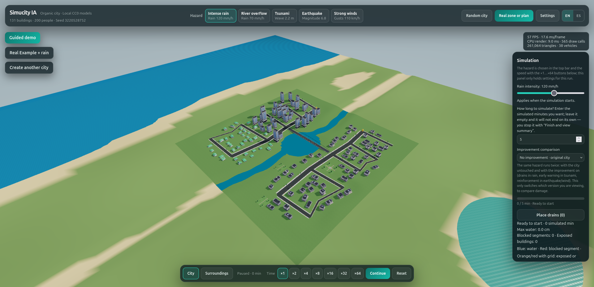
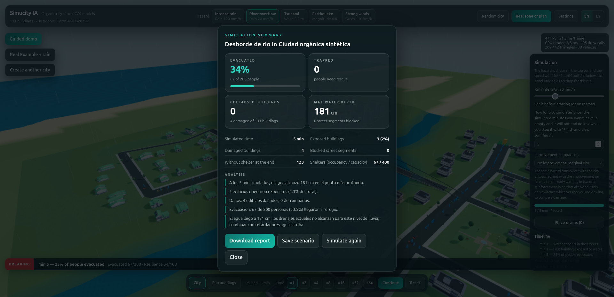
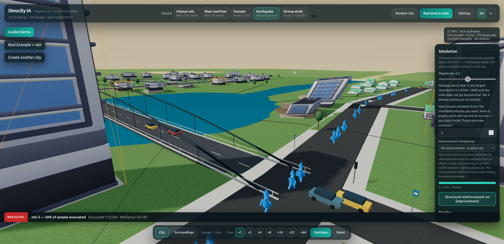
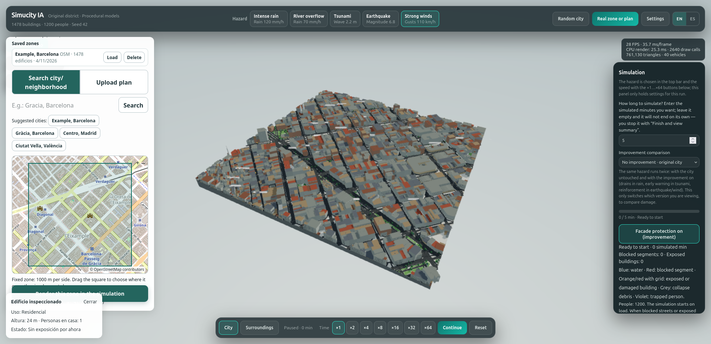

# Simulicity IA

> A synthetic 3D city simulator for exploring the impact of natural
> hazards (floods, earthquakes, tsunamis, strong wind) with same-seed
> before/after comparison and AI-assisted interventions.

**Demo video:** *\[YouTube link --- pending\]*



*The Simulicity IA start screen: choose to generate a city with AI, a
random seed, or import a real map.*

------------------------------------------------------------------------

## What is it?

Simulicity IA is a city simulator built with **Three.js**, **Next.js**,
and **React**. It procedurally generates synthetic cities (terrain,
water, streets, buildings, services, and citizens) and lets you run
**deterministic hazards** on them. Because generation is deterministic
per seed, you can compare the **before and after** of the same city
under the same hazard, and measure the impact on buildings, population,
and services.

The project also includes a **real-district importer from
OpenStreetMap**, and two optional AI features that propose city plans
and mitigation interventions (with a local fallback when no API key is
set).

> **Disclaimer**: this is an experimental project. It is not a
> scientific prediction tool or a certified emergency-management system.
> Coefficients are demonstrative and not calibrated.

------------------------------------------------------------------------

## Features

-   **Procedural city generation**: terrain, rivers, lakes, streets,
    blocks, buildings, parks, services, and population.
-   **Deterministic hazards**: rain/flood, river overflow, tsunami,
    earthquake, and strong wind.
-   **Before/after comparison** with the same seed: same scenario, same
    buildings, reproducible results.
-   **Real-district import** from OpenStreetMap.
-   **Optional AI** (Meta Model API) to propose city plans and
    mitigation interventions. Without a key, it falls back to a local
    plan labeled *"Sin IA (local)"*.
-   **Measured metrics**: exposed buildings, trapped people, max water
    depth, resilience score, etc.
-   **Simulation panel** with generation controls, hazard selection, and
    comparison.

------------------------------------------------------------------------

## Screenshots

### City generation and simulation



*A synthetic city generated procedurally, ready for simulation. The top
bar shows the active hazard and the right panel displays live simulation
metrics.*

### Simulation summary



*After running a hazard, the app shows a detailed summary: evacuated
population, trapped people, collapsed buildings, max water depth, and an
analysis of the impact.*

### Hazards and evacuation



*Earthquake simulation at street level: buildings shake, debris falls,
and citizens evacuate across the bridge.*

### Real district import



*Importing a real district (Barcelona's Eixample) from OpenStreetMap.
The 3D model is generated automatically from the map data.*

### AI-assisted interventions

*\[Pending capture: assets/ai.png\]*

*The intervention agent proposes bounded mitigations based on measured
metrics, labeled "Sin IA (local)" when no API key is set.*

------------------------------------------------------------------------

## How it works (technical summary)

1.  **Deterministic generation**: a seeded PRNG produces terrain,
    streets, blocks, buildings, and population. The same seed always
    produces the same city.
2.  **Hazard simulation**: each hazard applies a deterministic model on
    the city (water depth, structural damage, evacuation, etc.).
3.  **Comparison**: because the city is reproducible, the "before" and
    "after" states can be rendered side by side.
4.  **Optional AI**: the backend (or the local fallback) proposes plans
    and interventions from the measured metrics. Interventions are
    applied, the simulation is re-run with the same seed, and results
    are compared.

------------------------------------------------------------------------

## Stack

  Layer              Technology
  ------------------ -----------------------------------------
  Frontend           Next.js, React, Tailwind, Three.js
  City generation    Pure TypeScript (`@simulicity/cities`)
  Hazards            Pure TypeScript (`@simulicity/hazards`)
  Shared contracts   Zod (`@simulicity/shared`)
  Monorepo           pnpm workspaces + Turbo
  AI (optional)      Meta Model API (server-side)
  Deploy             Vercel (frontend only)

------------------------------------------------------------------------

## Getting started

Requirements: **Node.js 22.x** and **pnpm 10.x**.

``` bash
pnpm install
pnpm --filter @simulicity/web dev
```

Open <http://localhost:3000>.

### Environment variables (optional)

If you want to use the AI features, you need a Meta Model API key.
Without a key, the app still works and shows *"Sin IA (local)"*.

``` bash
# apps/backend/.env (only if you keep the AI backend)
META_API_KEY=LLM_...
```

> In the Vercel deployment (frontend only), AI features use the local
> fallback.

------------------------------------------------------------------------

## Repository structure

``` text
apps/
  frontend/        Next.js + Three.js + simulator UI
packages/
  cities/          Procedural city generator (deterministic)
  hazards/         Hazard and evacuation models
  shared/          Shared contracts and types (Zod)
scenarios/         Example scenarios (JSON)
assets/            Screenshots used in this README
```

------------------------------------------------------------------------

## Useful scripts

``` bash
pnpm build        # build the whole monorepo
pnpm lint         # ESLint
pnpm typecheck    # TypeScript
pnpm test         # Vitest
pnpm format       # Prettier
```

To build only the frontend (what Vercel does):

``` bash
pnpm turbo run build --filter=@simulicity/web
```

------------------------------------------------------------------------

## Deploy

The frontend is deployed on **Vercel** with:

-   **Root Directory**: `apps/frontend`
-   **Build Command**:
    `cd ../.. && pnpm turbo run build --filter=@simulicity/web`
-   **Install Command**: `cd ../.. && pnpm install --frozen-lockfile`
-   **Environment variables**: none (AI features fall back to the local
    plan)

The configuration lives in `apps/frontend/vercel.json`.

------------------------------------------------------------------------

## Limitations and disclaimer

-   **Experimental** project: not a scientific prediction or a certified
    emergency tool.
-   Hazard coefficients are **demonstrative**, not calibrated against
    real data.
-   OpenStreetMap import depends on OSM data availability and quality.
-   AI features are **optional** and not required to use the simulator.

------------------------------------------------------------------------

## Demo video

*\[YouTube link --- pending\]*

Suggested demo script:

1.  **Intro (10 s)**: what Simulicity IA is and what problem it
    explores.
2.  **Generate a city (20 s)**: show the panel, pick a seed, generate.
3.  **Run a hazard (30 s)**: select flood, show before/after and
    metrics.
4.  **Interventions (30 s)**: show the AI proposal (or the local
    fallback), apply it, compare.
5.  **Import a real district (20 s)**: load an OSM district and
    simulate.
6.  **Outro (10 s)**: limitations, stack, and repo link.

------------------------------------------------------------------------

## License

*\[to be defined --- MIT, Apache 2.0, etc.\]*

------------------------------------------------------------------------

## Credits

-   3D models: Kenney City Kit and Poly Haven (see
    `apps/frontend/public/models/`).
-   Real-district data: OpenStreetMap contributors.
